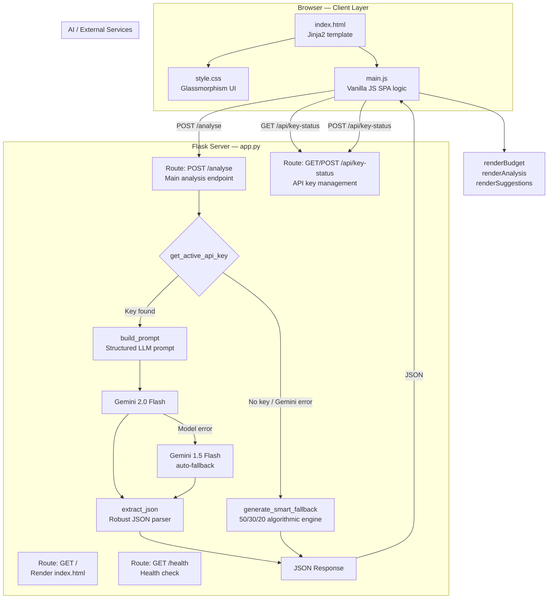
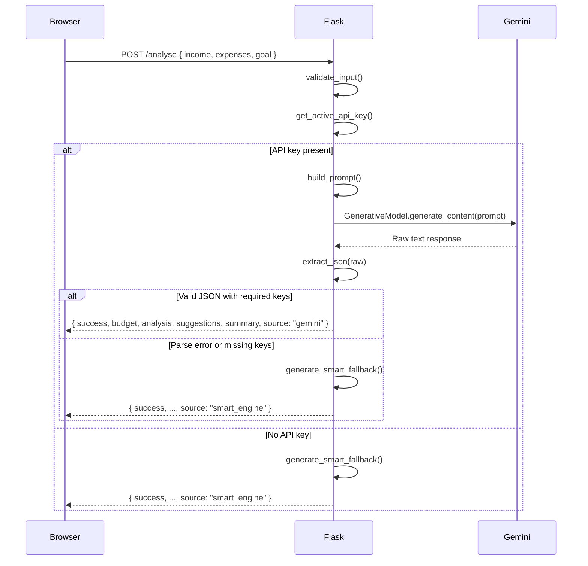

# System Architecture — FinanceBot

> **Related docs:** [README](../README.md) | [API Documentation](./API_Documentation.md) | [Database Models](./database.md) | [User Guide](./USER_GUIDE.md)

---

## 1. Overview

FinanceBot is a **stateless, single-page web application** built on a minimal Python/Flask stack.
There is no persistent database. Every HTTP request to `/analyse` carries all the data required to
produce a full financial analysis; results are returned in a single JSON response and rendered
client-side by Vanilla JavaScript.

The system supports two runtime modes that are selected automatically:

| Mode | Trigger | Engine |
|---|---|---|
| **Gemini Mode** | Valid `GEMINI_API_KEY` is present | Google Gemini 2.0 Flash (or 1.5 Flash fallback) |
| **Smart Advisory Engine** | No API key, or Gemini API error | Built-in algorithmic engine (50/30/20 rule) |

---

## 2. High-Level Architecture Diagram



---

## 3. Component Descriptions

### 3.1 Frontend (`templates/index.html`, `static/css/style.css`, `static/js/main.js`)

| File | Responsibility |
|---|---|
| `index.html` | Single Jinja2 template; renders the income/expense form, results section, and API key modal |
| `style.css` | Full design system — dark glassmorphism palette, CSS custom properties, responsive grid, animated progress bars |
| `main.js` | Collects form data, calls `/analyse` via `fetch()`, renders budget/analysis/suggestions dynamically; manages API key in `localStorage` |

**Key JS functions:**

| Function | Purpose |
|---|---|
| `collectFormData()` | Reads income, expenses, goal, and optional stored API key from the form |
| `renderBudget(budget)` | Renders animated budget cards with progress bars |
| `renderAnalysis(analysis)` | Renders spending status chips |
| `renderSuggestions(suggestions)` | Renders ordered saving suggestions list |
| `syncApiKeyStatus()` | On page load, checks `/api/key-status` and updates the header badge |
| `escapeHtml(str)` | Sanitises all dynamic strings before DOM insertion (XSS prevention) |

---

### 3.2 Backend (`app.py`)

Flask application with four routes and a set of pure-function helpers.

#### Routes

| Route | Method | Handler | Description |
|---|---|---|---|
| `/` | GET | `index()` | Renders `index.html` with category and goal metadata |
| `/analyse` | POST | `analyse()` | Core endpoint — validates input, calls AI or fallback, returns JSON |
| `/api/key-status` | GET | `key_status()` | Returns current mode (`gemini` / `smart_engine`) |
| `/api/key-status` | POST | `key_status()` | Accepts a new API key, writes to `.env` |
| `/health` | GET | `health()` | Lightweight health check |

#### Key Functions

| Function | Purpose |
|---|---|
| `get_active_api_key(client_key)` | Priority chain: client body key → env `GEMINI_API_KEY` → env `GOOGLE_API_KEY` |
| `validate_input(data)` | Type-checks income, whitelists expense categories, bounds-checks all values |
| `build_prompt(income, expenses, goal)` | Constructs a structured JSON-instruction prompt for the Gemini model |
| `extract_json(raw)` | Tries direct parse → markdown strip → regex extraction to handle any Gemini response format |
| `generate_smart_fallback(income, expenses, goal)` | Algorithmic fallback: computes recommended amounts, statuses, suggestions, and summary using `CATEGORY_TIPS` metadata |

#### Data Constants

| Constant | Description |
|---|---|
| `CATEGORY_TIPS` | Dictionary of 11 expense categories, each with `max_pct`, label, icon, and three tip strings |
| `GOAL_DESCRIPTIONS` | Dictionary of 8 financial goal keys mapped to natural-language descriptions |
| `PLACEHOLDER_KEYS` | Set of strings considered invalid API keys (empty, `your_api_key_here`, etc.) |
| `MAX_INCOME` | `10_000_000` (Rs 1 crore) |
| `MAX_EXPENSE` | `5_000_000` (Rs 50 lakhs per category) |

---

## 4. Frontend–Backend Communication

All communication is via **HTTP JSON**:

```
POST /analyse
Content-Type: application/json
X-Gemini-API-Key: <optional header>

{
  "income": 75000,
  "expenses": { "rent": 20000, "food": 8000, ... },
  "goal": "emergency_fund",
  "api_key": "<optional override>"
}
```

Response (success):

```json
{
  "success": true,
  "source": "gemini" | "smart_engine",
  "budget": [ ... ],
  "analysis": [ ... ],
  "suggestions": [ ... ],
  "summary": "..."
}
```

The API key is resolved server-side from three sources in priority order:
1. `api_key` field in the JSON body
2. `X-Gemini-API-Key` request header
3. `GEMINI_API_KEY` / `GOOGLE_API_KEY` environment variables

---

## 5. AI Analysis Workflow



---

## 6. Deployment Architecture

### Local (Development)

```
python app.py
  └── Flask dev server on 0.0.0.0:5000
```

### Public (Ngrok Tunnel)

```
python run_public.py
  ├── Flask thread on 127.0.0.1:5000
  └── pyngrok tunnel  →  https://<random>.ngrok-free.app
```

---

## 7. Security Considerations

- No user data is stored server-side; each request is fully self-contained.
- API keys submitted via the in-app modal are stored in `localStorage` (client) and optionally written to `.env` (server-side).
- All expense category keys are whitelisted against `VALID_CATEGORIES` before processing.
- Numeric inputs are bounded to prevent absurdly large prompt injection values.
- JavaScript output is HTML-escaped via `escapeHtml()` to prevent XSS.
