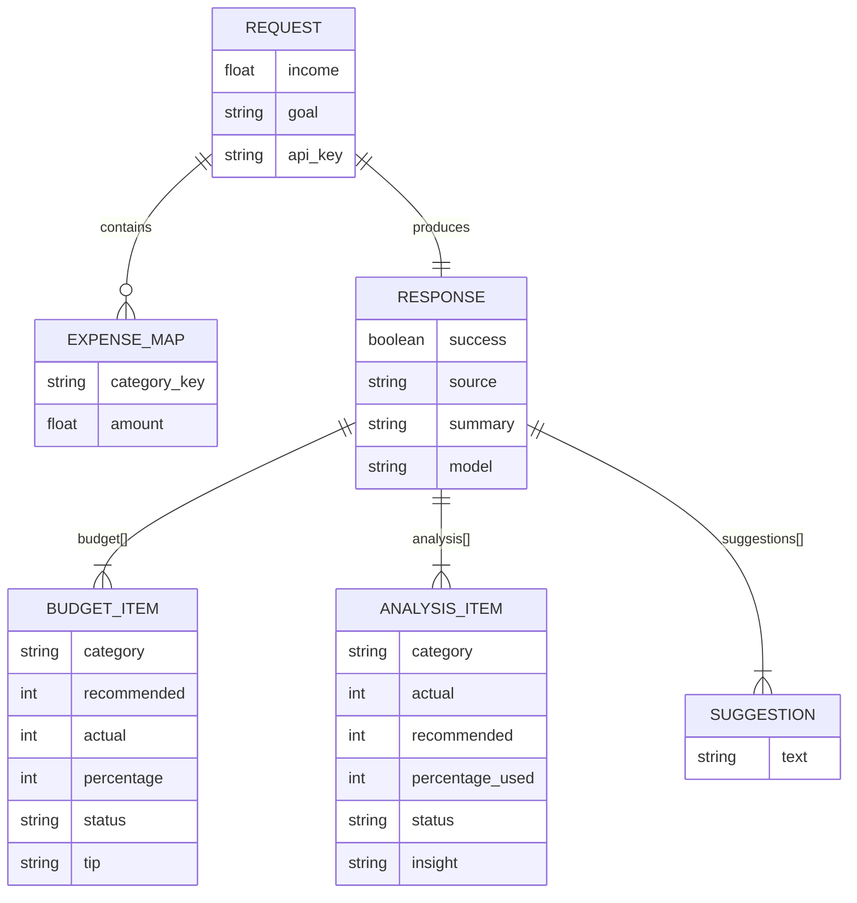

# Database Models — FinanceBot

> **Related docs:** [README](../README.md) | [Architecture](./architecture.md) | [API Documentation](./API_Documentation.md)

---

## Overview

FinanceBot is a **stateless application** — it does **not use a persistent database**.
All financial data (income, expenses, goal) is submitted by the user in a single HTTP request,
analysed in memory by the backend, and returned in the response. **Nothing is written to disk or stored.**

> ℹ️ This design was a deliberate choice to simplify deployment, protect user privacy, and avoid the need
> for authentication or session management in the current version.

---

## In-Memory Data Structures

Although there is no database, the application works with well-defined data shapes at runtime.
These are documented here as reference models.

---

### Request Payload (input to `/analyse`)

Submitted by the browser as a JSON body:

| Field | Type | Required | Constraints | Description |
|---|---|---|---|---|
| `income` | `float` | Yes | `> 0`, `<= 10,000,000` | Monthly net take-home income in INR |
| `expenses` | `object` | Yes | At least one valid category key | Map of expense category key to amount |
| `goal` | `string` | No | One of 8 valid goal keys; defaults to `emergency_fund` | Primary financial goal |
| `api_key` | `string` | No | — | Optional Gemini API key override from client |

**`expenses` object — valid category keys:**

| Key | Label | Recommended Max (% of income) |
|---|---|---|
| `rent` | Rent / Housing | 30% |
| `food` | Groceries and Food | 15% |
| `transport` | Transport | 10% |
| `dining` | Dining Out | 8% |
| `entertainment` | Entertainment | 8% |
| `utilities` | Utilities | 8% |
| `savings` | Savings | 20% (minimum target) |
| `health` | Health and Medical | 5% |
| `education` | Education | 10% |
| `shopping` | Shopping | 8% |
| `other` | Miscellaneous | 10% |

Any key not in this list is silently ignored by `validate_input()`.

---

### `goal` — Valid Values

| Key | Description |
|---|---|
| `emergency_fund` | Build a 6-month emergency fund |
| `vacation` | Save for a dream vacation within 12 months |
| `gadget` | Save for a major gadget purchase within 3–6 months |
| `investment` | Begin a disciplined investment portfolio (mutual funds / SIPs) |
| `debt_repayment` | Aggressively pay down existing debts or credit-card balances |
| `home_purchase` | Accumulate a down payment for a home within 2–5 years |
| `retirement` | Maximise long-term retirement corpus through consistent compounding |
| `education` | Save for higher education or professional certifications |

---

### `BudgetItem` (element of the `budget` response array)

| Field | Type | Description |
|---|---|---|
| `category` | `string` | Human-readable category label (e.g., `"Rent / Housing"`) |
| `recommended` | `integer` | Recommended monthly amount in INR |
| `actual` | `integer` | User's actual monthly spending in INR |
| `percentage` | `integer` | Recommended allocation as a percentage of income |
| `status` | `string` | `"ok"`, `"over"`, or `"under"` |
| `tip` | `string` | One actionable tip for this category |

---

### `AnalysisItem` (element of the `analysis` response array)

| Field | Type | Description |
|---|---|---|
| `category` | `string` | Human-readable category label |
| `actual` | `integer` | Actual monthly spending in INR |
| `recommended` | `integer` | Recommended monthly spending in INR |
| `percentage_used` | `integer` | Actual spending as a percentage of income |
| `status` | `string` | `"ok"`, `"over"`, or `"under"` |
| `insight` | `string` | One-sentence spending insight |

---

### Full Response Shape (`/analyse` success)

| Field | Type | Description |
|---|---|---|
| `success` | `boolean` | `true` on success |
| `source` | `string` | `"gemini"` or `"smart_engine"` |
| `budget` | `BudgetItem[]` | Per-category budget breakdown |
| `analysis` | `AnalysisItem[]` | Per-category spending analysis |
| `suggestions` | `string[]` | 4–6 actionable saving suggestions |
| `summary` | `string` | Two-sentence financial health summary |
| `model` | `string` | *(Gemini mode only)* Model used, e.g., `"gemini-2.0-flash"` |
| `note` | `string` | *(Smart Engine mode only)* Informational note |
| `has_api_key` | `boolean` | *(Smart Engine mode only)* Whether a key was active |

---

## Entity Relationship Diagram

Because there is no persistent database, the ERD shows the runtime data relationships
between the in-memory structures:



---

## Future Database Design (Planned)

If user accounts and history are added in a future version, the following schema is proposed:

```
users
  id          INTEGER PRIMARY KEY
  email       TEXT UNIQUE NOT NULL
  name        TEXT
  created_at  DATETIME

sessions
  id          INTEGER PRIMARY KEY
  user_id     INTEGER REFERENCES users(id)
  income      REAL NOT NULL
  goal        TEXT NOT NULL
  created_at  DATETIME

expense_entries
  id          INTEGER PRIMARY KEY
  session_id  INTEGER REFERENCES sessions(id)
  category    TEXT NOT NULL
  amount      REAL NOT NULL
```

> This is a **planned future enhancement** only. It is not implemented in the current codebase.
